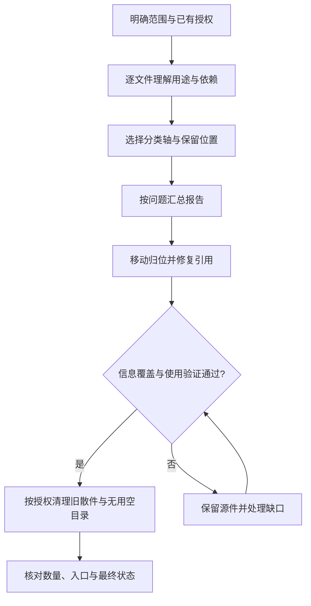

# organize-files · 文件科学整理

让文件按实际用途归位，将零散报告整理为能直接使用的结论与证据，并在授权范围内清除被完整替代的内容。

**最低要求：不丢失独有信息。** 整理后应能快速找到有效版本、相关资料、结论依据与必要的复现参数。

这是供 Codex 使用的指令型 skill，由 agent 阅读文件、判断用途并执行整理。它不包含自动清空目录的程序，也不承诺仅凭文件名识别所有冗余。

## 整理逻辑



存在外部阻塞时，保留受影响资料、报告未完成项并交付其余已验证成果，不无限循环重试。

### 1. 先理解每个文件的作用

从已有入口、项目配置和浅层目录开始，再深入混杂子目录。每个范围内文件须有用途和去向；保护项与外部链接先识别边界。

- 文字报告：全文阅读，核对附表、注释、不同版本和后续更正。
- 代码：检查入口、导入、资源路径及生成文件的位置。
- 数据与二进制：检查格式、结构、运行身份和必要配套。
- 环境、Git 内部、密钥和应用管理库：按范围保护，不盲目重排。

全文审阅、结构检查和字节校验分别说明。读取全部字节不代表理解全部内容。

### 2. 按查找需求分类

优先沿用合理结构，选择一个主要分类维度，再增加必要层级。

| 资料类型 | 常见组织方式 | 应保持的关系 |
|---|---|---|
| 多模型实验 | 模型 → 数据集 → 协议／运行 | 参数、权重、预测、指标 |
| 论文初稿与修订 | 阶段 → 实验问题 → 数据集／运行 | 图表、生成数据、对应结论 |
| 代码项目 | 保留程序结构，归整外围资料 | 导入、配置、资源和生成器 |
| 项目文档 | 主题 → 用途 | 原始来源、可编辑源稿、交付件 |
| 备份 | 资料组 → 恢复所需配套 | 恢复路径、校验与必要元数据 |

这些是示例，不是固定模板。根目录和内部子目录都在审查范围；相同用途的目录可合并，独立运行和合理的 `src`、`tests` 等接口继续保留。不以固定层数或文件夹数量作为唯一目标。

### 3. 报告按问题综合

合并不是把旧报告拼接起来，也不是只生成链接目录。主题报告应让读者理解当前结论、适用条件、关键结果、证据与必要限制。

例如，两份记录分别写“数据集 A，seed 7，分数 0.71”和“同一运行更正为 0.70123”，汇总应保留当前数值、旧数值、更正原因及来源身份。另一协议的低分结果有独立含义，不能当重复版本删除。

重复描述只保留一次；互补内容按问题归并；冲突保留条件与来源。逐项确认信息完整覆盖后，依已有授权删除旧散稿。需要精确保留的记录可集中存放，但必须能够读取或恢复，且不能用压缩旧目录代替内容综合。

### 4. 对每项资料作出明确处置

| 处置 | 判断依据 |
|---|---|
| 保留 | 当前使用、唯一证据、保护项或状态尚不明确 |
| 移动／重命名 | 用途明确，但位置或名称妨碍查找；迁移后依赖仍有效 |
| 合并 | 内容重复或互补，独有信息可以完整对应到保留位置 |
| 退役 | 当前流程不再使用；独有实现、参数及必要证据仍可取得 |
| 删除 | 已授权，无未保留信息、无未替代用途且没有活跃使用 |

`old`、`failed`、`tmp`、`.build`、日期和指标高低都不足以单独判断去留。失败结果与弃用代码分别处理：有意义的负结果保留，停用入口与仅供其使用的 helper 按调用关系一起审查。

### 5. 验证后收口

- 原样移动和去重：核对完整内容哈希及必要元数据。
- 报告汇总：逐项核对事实、精度、条件、更正和来源；哈希不能证明语义覆盖。
- 引用与运行：核对链接、配置路径和相关轻量入口，防止程序再次生成旧目录。
- 缓存：确认生成入口、保留输入及合理重建成本；训练结果不能仅凭“可重训”当缓存删掉。
- 压缩备份：验证成员内容及实际恢复能力；原始训练权重不降精度。
- 中断续跑：核对当前源和目标，再复用已验证项；不重复执行整套迁移。

文件、子目录、根目录一级项和占用分别按相同范围统计。通常只保留必要业务报告、入口、核心资料及来源映射；不额外堆积整理说明、迁移收据和无理由归档。

## 使用方式

安装到 Codex 的 skills 目录后，在任务中使用 `$organize-files`，并给出目标路径、保护项及清理范围。已有会话授权继续有效。

**深度整理并清理：**

```text
使用 $organize-files 整理 D:\Project。
逐文件检查用途，合并零散报告，精简根目录和混杂子目录。
允许删除信息已完整保留、依赖已替代的旧散稿和重复文件。
保留唯一源码、原始数据及每个采用种子的训练文件；不要生成额外归档。
完成后验证当前入口、引用和核心配套，简要说明变化与缺口。
```

**仅检查：**

```text
使用 $organize-files 检查 D:\Project，只审计，不移动或删除。
核对有效结果是否关联输入、代码、参数、权重、预测与指标，列出具体缺口。
```

**整理实验资料：**

```text
使用 $organize-files 整理 D:\Research\revision。
按现有实验问题分类，各运行保留训练与聚类参数、种子、权重、预测和指标。
报告按实验问题汇总，DOCX 和 PPTX 不修改。
允许清理已完全替代的散件，不重训，不按指标高低删证据。
```

多代理适用于用户明确要求的任务：每个范围指定执行者，共享索引只由一个 agent 写入；审查者根据真实结果指出具体问题。skill 不要求固定评委人格。

## 安装

仓库为私人仓库，需要具有访问权限的 GitHub 账号。以下 PowerShell 示例适用于默认 skills 位置，目标已存在时停止，避免覆盖本地修改：

```powershell
$skillRoot = if ($env:CODEX_HOME) {
    Join-Path $env:CODEX_HOME 'skills'
} else {
    Join-Path $env:USERPROFILE '.codex/skills'
}
$skillPath = Join-Path $skillRoot 'organize-files'
if (Test-Path -LiteralPath $skillPath) { throw '目标已存在，请先核对本地版本。' }
New-Item -ItemType Directory -Path $skillRoot -Force | Out-Null
gh repo clone 1-Vast/organize-files $skillPath
```

在 Codex 重新加载 skills 后使用。其他 agent 也可从 `SKILL.md` 开始阅读，再按任务读取相关参考文件。

## 文件说明

| 文件 | 职责 |
|---|---|
| [SKILL.md](SKILL.md) | Agent 入口：边界、处置标准和验收 |
| [深度整理流程](references/deep-organization.md) | 逐文件覆盖、报告合并、迁移和中断恢复 |
| [场景规则](references/scenarios.md) | 实验、代码、文档、备份与个人资料 |
| [清理故障处理](references/cleanup-troubleshooting.md) | 审批拒绝、系统权限、占用及内容变化的处理 |
| [MAESTRO 案例](references/maestro-example.md) | 历史实操及改进依据，不是目录模板 |
| [界面元数据](agents/openai.yaml) | 显示名称与默认调用提示 |

## 验收与边界

完成整理需同时满足：范围内文件有明确用途和去向、独有信息仍可获取、当前依赖有效、旧散件按授权清理、入口能帮助陌生使用者找到结论与依据。再次运行应复用现有结构，避免重复汇总。

已有隔离测试验证了报告更正与负结果保留、当前程序运行、退休源码恢复及7项文件删除。空目录删除曾被执行策略拒绝，不能声称所有环境下删除都已通过。案例中的数量是当次记录，不是对所有项目效果的承诺。

`blocked by policy` 与操作系统“权限不足”不同。应检查实际审批配置及规则，按工具返回处理；本 skill 不绕过平台审批，也不承诺通过更换命令消除未知拒绝。受阻部分保留并明确说明，其余独立工作继续。
