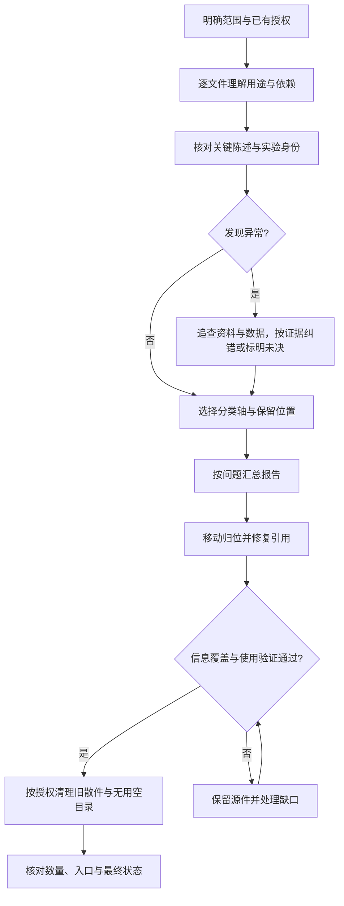

# organize-files · 文件科学整理

让文件按实际用途归位，核对内容、查证错误，将零散报告整理为能直接使用的结论与证据，并在授权范围内清除被完整替代的内容。

**当前目标：科学重构、详细综合报告和实际减少各类散件。** 不默认兼容旧路径、旧文件或历史命令；历史引用不构成原位保留理由。当前实现迁移后继续工作，停用代码与独有证据集中保留，获准替代的散件验证后清理。整理服务于检索效率、复现、追溯、成功/失败知识积累和长期协作；区分探索研究、已验证方法与正式成果，让证据关联结论、知识指导下一阶段决策。不能只搬目录、列导航或把旧树打包。

**最低要求：不丢失独有信息，并让后续研究能够使用。** 整理后应能找到有效版本、实验记录，以及方案选择、更正和失败修正的依据。

这是供 Codex 使用的指令型 skill，由 agent 阅读文件、判断用途并执行整理。它不包含自动清空目录的程序，也不承诺仅凭文件名识别所有冗余。

## 分层阅读

README 解释设计与用法；`SKILL.md` 是 agent 执行入口，其余内容按场景读取。

| 层级 | 阅读入口 | 何时使用 |
|---|---|---|
| 执行入口 | [SKILL.md](SKILL.md) | 开始整理，确认范围、处置和验收 |
| 判断纠错 | [内容判断与证据纠错](references/evidence-review.md) | 数字冲突、可疑结论、口径差异或失效记录 |
| 科研治理 | [代码与滚动报告](references/research-governance.md) | 现役代码质量/性能、失败实现退役、报告生命周期和证据等级 |
| 操作细节 | [深度整理流程](references/deep-organization.md) | 大型或混杂目录、报告合并与迁移 |
| 研究接续 | [场景规则](references/scenarios.md#研究实验与模型资料) | 科学经验、实验资料与后续研究 |
| 特定场景 | [场景规则](references/scenarios.md) | 代码、文档、压缩备份或个人资料 |
| 受阻处理 | [清理故障处理](references/cleanup-troubleshooting.md) | 审批拒绝、占用或内容变化 |
| 工具与评价 | [质量基准](references/quality-benchmark.md) | 可重复工程回归、科研接续问题及同输入比较 |
| 实践参考 | [MAESTRO 案例](references/maestro-example.md) | 理解历史实操，不作为固定模板 |

[界面元数据](agents/openai.yaml) 定义 skill 名称与默认调用提示。

## 整理逻辑



存在外部阻塞时，保留受影响资料、报告未完成项并交付其余已验证成果，不无限循环重试。

### 1. 先理解每个文件的作用

从已有入口、项目配置和浅层目录开始，再深入混杂子目录。每个范围内文件须有用途和去向；保护项与外部链接先识别边界。

- 文字报告：全文阅读，核对附表、注释、不同版本和后续更正。
- 代码：检查入口、导入、资源路径及生成文件的位置。
- 数据与二进制：检查格式、结构、运行身份和必要配套。
- 环境、Git 内部、密钥和应用管理库：按范围保护，不盲目重排。

全文审阅、结构检查和字节校验分别说明。读取全部字节不代表理解全部内容。

### 2. 判断内容是否可信、是否仍适用

整理时发现问题，要追查相应资料或数据并纠正可证实的错误，而非将原话直接搬进新报告。先确认对象和口径，优先查本地实验记录、配置与代码；需要外部依据时定向查原论文或官方资料，读取相关内容。必要时复算已有数据，避免将“最新”或“指标最高”当正确依据。

| 类似情况 | Skill 应作的判断 |
|---|---|
| 把最佳单次写成多种子均值 | 按实际运行清单复算，纠正报告及相关表格 |
| 两份报告数字冲突 | 查数据版本、协议、单位、样本和统计口径；区分错误与不可比结果 |
| 运行失败被解释为方法无效 | 查错误日志与产物，区分执行错误和有效负结果 |
| 将相关性写成因果，或无检验却称显著 | 查对应分析，将当前表述限定到证据支持的程度 |
| 旧报告写“已同步／可复现”但配套缺失 | 核对当前可用资料与恢复入口，修正状态和下一步依赖 |
| 多份汇总重复同一无来源结论 | 回到最初证据，避免把副本数量当成佐证强度 |
| 论文引用或参数说明与记录不符 | 查适用版本的一手资料；外部结果不能替代本次实验 |

证据充分时直接修正获准维护的报告，并保留“原说法—核验依据—当前结论”。证据不足则撤下无依据的确定性表述、保留分歧和所缺证据，不猜测答案。正确的低分或反例继续保留；原始数据和冻结记录不改写。

纠错后检查相关表格、导航和下一步验收条件，防止旧错误继续传播。需新实验、模型修改或昂贵复现才能判断的问题，作为具体后续任务交接；整理本身不自动启动这些工作。规则详见 [内容判断与证据纠错](references/evidence-review.md)。

### 3. 按查找需求分类

优先沿用合理结构，选择一个主要分类维度，再增加必要层级。

| 资料类型 | 常见组织方式 | 应保持的关系 |
|---|---|---|
| 多模型实验 | 模型 → 数据集 → 协议／运行 | 参数、权重、预测、指标 |
| 论文初稿与修订 | 阶段 → 实验问题 → 数据集／运行 | 图表、生成数据、对应结论 |
| 代码项目 | 保留程序结构，归整外围资料 | 导入、配置、资源和生成器 |
| 项目文档 | 主题 → 用途 | 原始来源、可编辑源稿、交付件 |
| 备份 | 资料组 → 恢复所需配套 | 恢复路径、校验与必要元数据 |

这些是示例，不是固定模板。根目录和内部子目录都在审查范围；相同用途的目录可合并，独立运行和合理的 `src`、`tests` 等接口继续保留。不以固定层数或文件夹数量作为唯一目标。

### 4. 报告按问题综合

合并不是把旧报告拼接起来，也不是只生成链接目录。主题报告应让读者理解当前结论、适用条件、关键结果、证据与必要限制。

例如，两份记录分别写“数据集 A，seed 7，分数 0.71”和“同一运行更正为 0.70123”，汇总应保留当前数值、旧数值、更正原因及来源身份。另一协议的低分结果有独立含义，不能当重复版本删除。

重复描述只保留一次；互补内容按问题归并；冲突保留条件与来源。逐项确认信息完整覆盖后，依已有授权删除旧散稿。需要精确保留的记录可集中存放，但必须能够读取或恢复，且不能用压缩旧目录代替内容综合。

### 5. 对每项资料作出明确处置

| 处置 | 判断依据 |
|---|---|
| 保留 | 当前使用、唯一证据、保护项或状态尚不明确 |
| 移动／重命名 | 用途明确，但位置或名称妨碍查找；迁移后依赖仍有效 |
| 合并 | 内容重复或互补，独有信息可以完整对应到保留位置 |
| 退役 | 当前流程不再使用；独有实现、参数及必要证据仍可取得 |
| 删除 | 已授权，无未保留信息、无未替代用途且没有活跃使用 |

`old`、`failed`、`tmp`、`.build`、日期和指标高低都不足以单独判断去留。失败结果与弃用代码分别处理：有意义的负结果保留，停用入口与仅供其使用的 helper 按调用关系一起审查。

### 6. 验证后收口

- 原样移动和去重：核对完整内容哈希及必要元数据。
- 报告汇总：逐项核对事实、精度、条件、更正和来源；哈希不能证明语义覆盖。
- 引用与运行：核对链接、配置路径和相关轻量入口，防止程序再次生成旧目录。
- 缓存：确认生成入口、保留输入及合理重建成本；训练结果不能仅凭“可重训”当缓存删掉。
- 压缩备份：验证成员内容及实际恢复能力；原始训练权重不降精度。
- 中断续跑：核对当前源和目标，再复用已验证项；不重复执行整套迁移。

文件、子目录、根目录一级项和占用分别按相同范围统计。通常只保留必要业务报告、入口、核心资料及来源映射；不额外堆积整理说明、迁移收据和无理由归档。

## 科学经验与后续研究

科研整理保留一条可追踪的关系：

**问题与假设 → 尝试及对照 → 实验观察 → 解释与限制 → 采用／弃用依据 → 下一步。**

例如，强平滑方案在一个数据集上降低分数，应保留其数据、协议、参数、结果及已尝试的修正。若“弱信号被抹掉”只是推测，就保留为待验证解释；不能写成已证实机制，也不能因为方案弃用而删除这段经验。环境错误导致的未完成运行则不能作为方法无效的证据。

采用运行与支撑重要经验的探索运行均需能够定位。训练、聚类读出和统计汇总各有明确身份；多种子均值关联到实际纳入的运行，而不只留一个最佳模型。未知信息写明缺失，整理不补造历史。

### 整理后的报告如何阅读

将接续内容融入已有入口与主题报告，按实际资料采用以下层次，无关项省略，不额外生成整套交接文件：

| 阅读顺序 | 内容 | 后续 agent 应能回答 |
|---|---|---|
| 1. 当前认识 | 有效结论、限制、选择及失败经验 | 目前知道什么，为什么这样判断？ |
| 2. 实验依据 | 运行身份、协议、参数、数据与产物 | 依据来自哪次实验，资料在哪里？ |
| 3. 使用方法 | 已有入口、工作目录、环境与验证状态 | 如何复核，哪些部分尚不能运行？ |
| 4. 接续任务 | 已计划下一步、依赖、阻塞与完成判据 | 下一步做什么，怎样判断完成？ |

短段落写结论和限制，小表格对齐可比结果，配置与长命令链接到权威文件。状态明确写“已核验”“未核验”“仅远端”或项目已有等价术语，避免只靠颜色、目录名或 `final` 表达有效性。没有后续计划时写“未记录”；新建议与已授权任务分开。

验收使用一个不依赖聊天历史的接续任务：从入口找到一个结论、定位运行，并在存在取舍或失败经验时说明依据。有已计划后续任务时执行已授权的低成本复核或指出阻塞，无后续计划则明确未记录或已结束。该抽查检验可用性，全部待删资料仍须逐项核对信息覆盖。

## 使用方式

安装到 Codex 的 skills 目录后，在任务中使用 `$organize-files`，并给出目标路径、保护项及清理范围。已有会话授权继续有效。

**深度整理并清理：**

```text
使用 $organize-files 整理 D:\Project。
逐文件检查用途，合并零散报告，精简根目录和混杂子目录。
允许删除信息已完整保留、依赖已替代的旧散稿和重复文件。
保留唯一源码、原始数据及每个采用种子的训练文件；不要生成额外归档。
完成后验证当前入口、引用和核心配套，简要说明变化与缺口。
```

**仅检查：**

```text
使用 $organize-files 检查 D:\Project，只审计，不移动或删除。
核对有效结果是否关联输入、代码、参数、权重、预测与指标，列出具体缺口。
```

**整理实验资料：**

```text
使用 $organize-files 整理 D:\Research\revision。
按现有实验问题分类，各运行保留训练与聚类参数、种子、权重、预测和指标。
报告按实验问题汇总，保留已有假设、采用与弃用依据、失败修正经验。
发现数字或结论问题，查证数据和相关资料后修正；无法确定则明确分歧。
交接写清复核入口、验证状态、已计划下一步和完成判据。DOCX 和 PPTX 不修改。
允许清理已完全替代的散件，不重训，不按指标高低删证据。
```

多代理适用于用户明确要求的任务：每个范围指定执行者，共享索引只由一个 agent 写入；审查者根据真实结果指出具体问题。skill 不要求固定评委人格。

## 安装

仓库为私人仓库，需要具有访问权限的 GitHub 账号。以下 PowerShell 示例适用于默认 skills 位置，目标已存在时停止，避免覆盖本地修改：

```powershell
$skillRoot = if ($env:CODEX_HOME) {
    Join-Path $env:CODEX_HOME 'skills'
} else {
    Join-Path $env:USERPROFILE '.codex/skills'
}
$skillPath = Join-Path $skillRoot 'organize-files'
if (Test-Path -LiteralPath $skillPath) { throw '目标已存在，请先核对本地版本。' }
New-Item -ItemType Directory -Path $skillRoot -Force | Out-Null
gh repo clone 1-Vast/organize-files $skillPath
```

在 Codex 重新加载 skills 后使用。其他 agent 也可从 `SKILL.md` 开始阅读，再按任务读取相关参考文件。

## 验收与边界

标准库工具将精确验证和成本测量从自然语言判断中分离：

- `scripts/organization_ops.py`：显式文件计划的 `dry-run`、`apply` 和 `rollback`；修改前验证外置恢复包，回滚拒绝覆盖后续改动。`protected_sources` 限制源、目标和替代源，默认敏感路径也在读取前拒绝。它是可恢复的逐文件执行，不是跨文件原子事务或完整 NTFS 备份，仍受环境审批约束。
- `scripts/evidence_index.py`：`validate`、`snapshot` 严格校验，`scan` 只筛选元数据候选并保持未验证，`impact` 只接受严格快照、传播变化/错误及保护依赖。不能用大小或时间相同代替完整性验证。
- `scripts/workspace_scout.py`：一次元数据盘点及外部快照；后续输出变化候选，仍遍历未排除目录。先声明项目保护/opaque范围，不读payload，不用元数据相同授权删除。
- `scripts/task_context.py`：单进程任务内批量摘录和事实结果复用，绑定哈希、来源行号、依赖及未决问题；固定快照不代表当前文件，`fresh=True`重读后检查失效，不跨任务自动保存。
- `scripts/research_navigation.py`：检查登记研究、索引和正文章节的身份对应；静态候选须结合内容复核，不能自动判为科学错误。
- `scripts/claim_coverage.py`：Python API 将选定事实的六维契约、来源字节与报告引文绑定到审阅记录；字段匹配不能证明语义蕴含、全量覆盖或授权删除。
- `scripts/benchmark_organization.py`：对显式索引测严格校验与筛选的耗时/I/O，或在外部合成目录测文件预演；`--trace`汇总显式本地Codex日志的实际用量和运行时区间，不输出原文。只输出JSON，不改项目报告；操作示例及计量边界见[质量基准](references/quality-benchmark.md)。

从仓库根运行 `python -m pytest tests -q`。运行只需 Python 3.11+ 和 pytest；使用说明与评价边界见[质量基准](references/quality-benchmark.md)。工程回归覆盖恢复、保护范围、路径边界、冻结内容、元数据筛选、增量影响和报告生命周期。未执行真实三方法比较或正式跨 Agent 盲测，不能据此宣称优于普通整理。

完成整理需同时满足：范围内文件有明确用途和去向、独有信息仍可获取、当前依赖有效、旧散件按授权清理、入口能帮助陌生使用者找到结论与依据。再次运行应复用现有结构，避免重复汇总。

既有隔离研究测试中，新 agent 未读取原始笔记，仅通过整理后的入口与报告重算两组保存指标均值（0.65、0.60），正确识别数值更正、弃用依据、依赖错误及复现缺口。报告回写受测试权限限制，分析结果已完成；测试验证的是已有指标汇总的接续能力，不是原实验科学结论。

内容判断测试另使用构造样例：agent 依据清单与数据纠正均值、重复计数、误差定义和阶段标签，区分跨数据集结果、执行失败与未决冲突，并修正缺失资产的可复现声明。仅现行报告与入口改动，其余8份原始／冻结／正确资料哈希不变。此测试验证局部纠错行为，不能保证发现所有类型的科学错误。

已有隔离测试验证了报告更正与负结果保留、当前程序运行、退休源码恢复及7项文件删除。空目录删除曾被执行策略拒绝，不能声称所有环境下删除都已通过。案例中的数量是当次记录，不是对所有项目效果的承诺。

`blocked by policy` 与操作系统“权限不足”不同。应检查实际审批配置及规则，按工具返回处理；本 skill 不绕过平台审批，也不承诺通过更换命令消除未知拒绝。受阻部分保留并明确说明，其余独立工作继续。

## 更新日志

### 2026-10-25 · Agent工作过程优化

- 三名代理各负责一个问题：动态阅读及快速收口、任务内证据复用、完整增量清单及敏感元数据脱敏。按影响和未决问题选择深度重构／局部增量／快速结束；元数据无变化不能跳过明确的深度请求或未完成工作。独立主题只并行分析，共享产物由一人执行。
- 新增短生命周期`TaskContext` API，一次合批读取有界文本，后续复用事实声明、精确位置与依赖；发现变化、读取失败或依赖修订则待复核。保留未知问题、同尺寸/mtime变化检查和删除前独立核验；不搭数据库，不自动证明语义。
- `workspace_scout`增加`--changes-out`及`include_changes=True`：完整输出所有变化候选，stdout标记预览截断，避免第21项以后被漏查。防止覆盖previous/其他输出，敏感目录、文件和链接统一只计数。
- 实际MAESTRO的7项已发布文本在同进程三轮摘录中仅读取7次／55,306字节，复用14次；6条选定事实绑定仍通过。外部探针中同大小且恢复mtime的字节变化使依赖记录失效。当前项目940文件无变化，业务报告、索引、登记的哈希及mtime未改。此为工具复用验证，不能填作Agent端到端提速。

### 2026-10-25 · 速度专项：先测端到端成本

- 审查PR #2并在Windows修复三个实际边界：opaque大小写、保护目录作为根、外部junction快照写回项目。先明确排除范围再盘点；同轮复用结果，稳定资料不反复全文读，适用的测试结果不重复执行。删除前哈希、语义覆盖与恢复保障保留。
- Windows的10,000个合成文件两次盘点为0.104／0.093秒；MAESTRO明确排除数据、包、环境后为940文件／178目录，两次0.037／0.034秒。扫描仍遍历范围内目录；它不是只扫描变化文件，也不是0.1秒完成科学整理。
- 未变化MAESTRO的自动维护检查合计约1.01秒，包含严格核验6个现役来源／9个历史来源、6条事实绑定和39项导航。固定身份来源在同一进程内实际读取9项、返回76,669字节，后续命中7次；三份业务报告/索引/登记哈希及mtime不变，无需重跑未变项目的全套软件测试。此时间不含Agent理解、报告综合或完整整理对照。
- 从当前主会话的真实本地日志恢复约56.17分钟任务的成本：116条有用量记录的响应、260个命令事件；输入15,252,021 tokens（含14,640,512缓存输入）、输出80,377。运行时Reasoning区间并集约18.00分钟，命令约11.35分钟，上下文压缩约2.76分钟，未归因约26.50分钟；各类可能重叠，不能相加或将Reasoning等同科研理解。子代理另计，精确重复阅读比例及理解/综合拆分仍N/A。日志原件未发布。
- Windows原执行器150项合成移动＋精确回滚：8.38＋7.58秒；603次state同步合计3.80秒／35,498,075字节，约占23.8%。保留所有原fsync、哈希和恢复校验。该小批次结果不外推到1,500项；当前维护无文件变更，故本轮未将追加式日志接入正式路径。
- 端到端减少50%仍是待验证目标，未进行同模型/同快照/同质量预算对照，不用局部盘点或工具检查时间宣称达标。
- 最终干净检出回归为**223 passed、1 skipped**，后者为Windows符号链接创建权限；保护根、opaque大小写及不依赖该权限的reparse检查均通过，实际junction反例另经独立复核。

### 2026-10-25 · 第三轮：导航与事实保持

- 完成 PR #1 的回归与真实使用检查；复核 MAESTRO 全部39项登记研究，修正14项主章节导航，其他索引字段保留不变。导航工具增加正文身份边界、代码块排除及重复标题处理。
- 历史 `source_ids` 可通过显式可信字节读取器真核验；默认未核验，scan不调用读取器。来源变化传播待复核，不自动推翻科学结论；区分检查有效与来源核验完整。
- 新增选定事实覆盖API及真实MAESTRO夹具，绑定结果、条件、协议、证据等级、限制和执行状态，来源/引文变化使审阅失效。来源可核验和独立内容审阅缺一不可；不宣称自动语义证明、全量覆盖或删除许可。
- 实际发现并纠正KG解析值与Monte Carlo估计混淆，补全G1严格净收益门槛及群体、legacy重放限制、开发集/未执行状态；保留原始记录和原有停止决定。六例前态为1项通过、5项受阻，包含1个数值身份错误与4处选定覆盖不足，不是五个科学结论错误。
- Skill工程回归为**203 passed**，包含独立审查发现的保护ID别名、布尔/数值混同、空事实和读取异常回归；39项导航严格检查无剩余候选。本地严格核验6个现役来源和9个历史来源，完整核验后7个对象可复用；模拟关键结果变化会使5个相关对象待复核。六条事实契约另经独立内容审阅通过，并可在无数据包的干净检出核验；完整证据图仍依赖本地数据及其原始字节身份。
- 明确知识接续、计算复核、实验复现分别验收。真实固定模型/同预算Agent对照、会话Token及普遍方法优势未测，记N/A；不以本轮工程回归代替这些评价。
- MAESTRO无本地数据包的干净检出完整软件测试为**1,095 passed、4 skipped**；三条本地资产路径缺失和一项本地原字节/Git换行表示差异仍使完整实验输入图保持未完整核验，不将软件测试通过写成实验复现成功。
- 验收工作树时发现一个合成示例测试写回已跟踪研究JSON，Windows上改变换行字节；将测试输出隔离到临时目录并检查原件不变，治理规则补充测试副作用检查，未改冻结实现或结果。

### 2026-10-25 · 发布接续检查

- 根据MAESTRO实际发布检查，补齐“本地可恢复”与“远端可恢复”的区别；完整整理成果与仅代码补丁按用户范围判断，关键信息发布不默认包含数据、权重、环境或封存资料。
- 关键来源复用固定Git提交/blob，区分Git规范化文本与本地原字节，独有未入库文本另行保全。清理后不能只留下远端无法读取的本地研究包路径。
- 增加拟提交树的干净检出与浅克隆检查；默认软件回归和真实资产集成检查分开，后者启用后缺失资产必须失败。发布、科研整理与数据级复现分别报告。
- [MAESTRO实际发布](https://github.com/1-Vast/LLM/commit/f1a71ff0eef7dd8db5360cc8206193045888887c)新增约3.8 MB来源清单及补充原文，覆盖3,943个来源身份；报告197个引用中193个可读、4个本地数据依赖明确排除。无本地数据包的干净检出为1,094 passed、4 skipped；另由代理真实读取更正与失败依据进行接续抽查，不冒称正式盲测。细节见[案例](references/maestro-example.md#关键信息发布与干净检出接续2026-10-25)。

### 2026-10-25 · 第二轮深度审查升级

- 增加现役代码质量与性能审查、失败实现的证据保全/退役、滚动报告及结论证据契约。无实质变化不重写报告，不把开发集观察提升为正式验证；科研重构和物理清理分别验收。
- 文件预演用路径段索引替代两两遍历；执行计划增加保护范围，恢复包封存计划，防止仅编辑state放宽范围。旧恢复包缺少此绑定，需隔离审查恢复，不自动兼容。
- 新增不读payload的元数据scan及真实I/O计数；严格校验保留必要哈希。修复保护来源/根及依赖误复用、错误路径丢失读取计数等边界，提供可重复性能CLI和二次整理/报告生命周期回归。
- 本机固定合成输入600项预演、两次测量的中位时间：7b54715为62.776秒，升级版2.494秒；新版6,000项为28.416秒。40项执行/回滚保持精确恢复和必要哈希次数。不同缓存、磁盘、路径深度会改变结果，不代表整体整理提速25倍。
- 同一选定约60 MiB材料，两次严格校验各读取62,977,024字节，scan读取0字节；scan所有对象仍未验证。真实Agent总耗时、Token及普遍科研质量优势未测，记N/A。
- MAESTRO本地使用测试发现并修复：读取器重复索引加载、一个失效锚点、盘点打开保护项/大二进制整体载入、签名库及校准的读取与哈希身份不一致、Level5仅凭尺寸/历史回执误报验证成功。修复以隔离回归验证，未训练模型或读取真实封存结果；MAESTRO改动留在本地，发布内容为本Skill。
- 最终Skill回归为**124 passed**；MAESTRO默认套件为**1,091 passed、3 skipped**（其中1项新增目录符号链接检查受本机创建权限限制，另有不依赖该权限的reparse属性回归）。入口以tiktoken 0.12.0的`o200k_base`编码为**2,746→1,420 tokens**；这是入口文本计数，实际会话Token为N/A，不能推断模型总成本同比下降。
- 重复整理实测保持科研总报告、研究索引和登记的哈希/mtime不变，现行总报告仍1份。选定真实研究索引严格校验6来源/480,874字节，scan为0字节；697文件的科研盘点中6项保护payload未打开。物理文件8,358→8,359，增加1个必要回归测试模块，未为凑数删除现役代码或独有证据。
- Windows目录删除的外部策略限制仍未宣称解决；公开相似issue不等于本机根因，无权限条件变化不重复受阻动作。

### 2026-10-25 · [7b54715](https://github.com/1-Vast/organize-files/commit/7b54715fe3a9bb18f02b0e9c2af1a0c269b47592)

首次加入科研证据索引、可恢复文件操作、同输入质量基准及67项工程回归；明确默认不兼容旧路径，以详细科研综合、真实数量变化和接续能力验收。历史测试数量对应当时版本，不代表当前覆盖或科学正确性保证。
